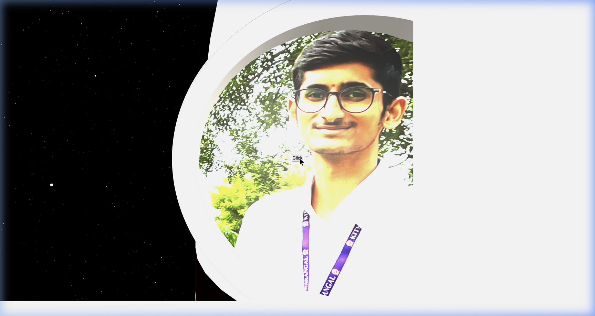
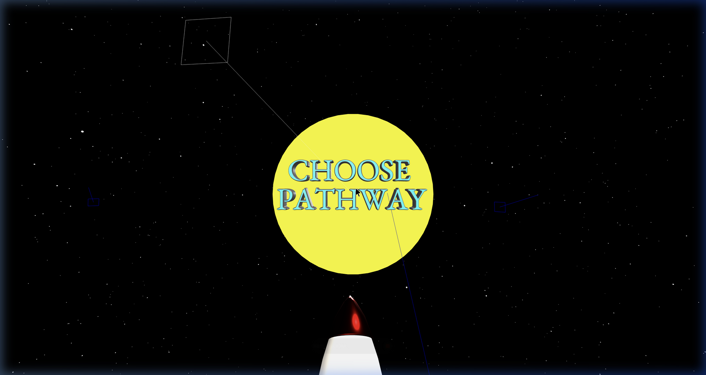
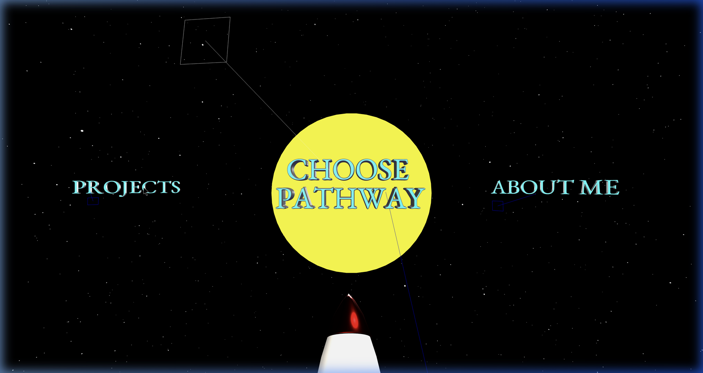
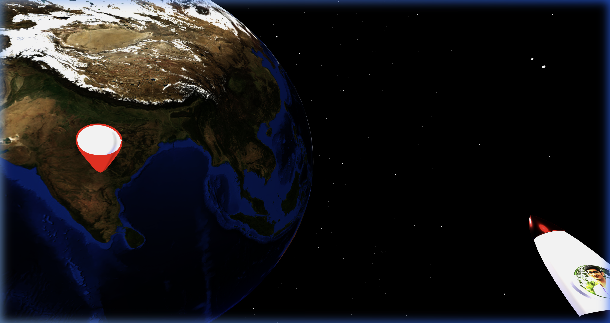

# Space-Themed 3D Portfolio Project Overview

## What it is about
This project is an immersive, interactive 3D web portfolio built around a space exploration theme. Instead of traditional scrolling to navigate between sections like "Projects" and "About Me", the user experiences a cinematic journey through space, flying a rocket ship between 3D destinations (like an Earth model) within the universe.

## How it is made
The project leverages the following core technologies:
* **Three.js**: Used as the primary 3D rendering engine. It handles laying out the scene, setting up cameras, lighting (directional and ambient), shadow mapping, rendering 3D GLTF models, creating the starfield, and generating 3D typography (TextGeometry).
* **GSAP (GreenSock Animation Platform)**: Handles all the complex, timeline-based cinematic animations. It is used to smoothly animate the camera and the rocket's position and rotation over specific durations, creating a heavily curated "cutscene" feel when transitions happen.
* **Vite**: The build tool and local development server running the underlying JavaScript environment.
* **HTML/DOM Overlays**: Hidden DOM elements (`
`s and `<button>`s) positioned over the WebGL canvas are used to trigger Interactions (clicks and hovers), sidestepping the need for complex internal 3D raycasting for UI elements.

## Scene Elements
* **The Starfield**: 5,000 tiny white spheres scattered randomly across the 3D space to act as a deep-space backdrop.
* **Lighting**: Multiple directional lights (some casting shadows) that dramatically light the 3D text. Dynamic blue lights (`DirectionalLightHover`) are animated in intensity when hovering over elements.
* **3D Models**: 
  - `FinalRocket.glb`: The main vessel/protagonist of the experience.
  - `FinalEarthModel.glb`: The destination for the "About Me" segment.
  - `LocationMarker.glb`: A drop pin emphasizing arrival at Earth.
* **3D Typography**: Uses `EB_Garamond` font geometries for "CHOOSE PATHWAY", "PROJECTS", and "ABOUT ME" navigation text.

## How it looks in the browser
When you first load the page at `localhost:5173`:
1. **Intro Sequence**: The view starts behind the nose of a rocket ship against the starry sky. Pressing the "Click" button fires off an energetic camera sequence where the rocket does flips while flying forward, and the camera pans smoothly.

   
2. **The Hub**: The rocket arrives facing a giant hovering yellow circle featuring beveled 3D text glowing dynamically in space that says "CHOOSE PATHWAY". 

   

3. **The Options**: Clicking the center reveals the options "PROJECTS" to the left and "ABOUT ME" to the right. 

   
4. **Hover Interactions**: Hovering over these options causes a blue spotlight to illuminate them, and they scale up slightly.
5. **The Journey**: Clicking "PROJECTS" triggers the rocket to blast off-screen while the camera spins rapidly into space. Clicking "ABOUT ME" has the rocket gracefully fly across the space over to the distant Earth model, with the camera trailing right behind it before settling into a beautiful wide shot of Earth as a giant location marker pins down.

   
