# Scene 1:

Here is the locked-in Sequence 1 (The Room):

* **The Scene:** Inside a cozy, high-tech space station room with a massive window showing the dark cosmos and your rocket docked outside.
* **The Text:** "Hi, I am Venkat Koppula" floating in dynamic, glowing 3D geometry.
* **The Avatar:** A 3D doodle of you standing next to the text, actively waving at the user.
* **The Action:** Clicking the glowing "BLAST OFF" button rapidly pulls the camera backward, flying out through the viewport into open space to reveal the station exterior.

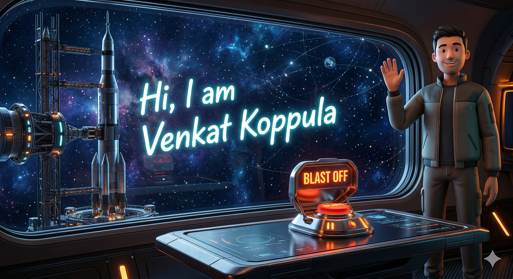

# Scene 2:

Here is how we can structure the **"Choose Destination"** UI and those two worlds:

### The Selection Screen (The UI)

The holographic screen projecting from the station shows two distinct visual targets:

* **Target A: The "Koppula System" (Projects):** A cluster of vibrant, multi-colored planets orbiting a central data-star.
* **Target B: The "Origin Planet" (About Me):** A single, high-fidelity Earth-like planet (your `FinalEarthModel.glb`).

### 2.1. Destination One: The Projects Solar System

Instead of just one planet, the rocket flies toward a **Solar System** where each planet represents a different category or specific project:

* **The Visual:** A "Sun" made of pulsing code/logic at the center.
* **The Planets:** * A **Neon Blue Gas Giant** for AI & Reinforcement Learning.
  * A **Rust-Colored Industrial Planet** for Thermal Simulations and Python scripts.
  * A **Crystal Fragment Planet** for Knowledge Graphs and Ontology.
* **The Interaction:** As the rocket flies *between* these planets, thumbnails or "pics" of the projects float in space like orbital billboards.

### 2.2. Destination Two: "My Planet" (The About Me)

This is the personal "Home Base."

* **The Visual:** Your specific Earth model.
* **The Transition:** The rocket leaves the station and performs a cinematic "de-orbit" maneuver.
* **The Content:** As the `LocationMarker.glb` drops onto the surface, it opens up your "About Me" details—your experience, skills, and background—projected against the beautiful curve of the planet.

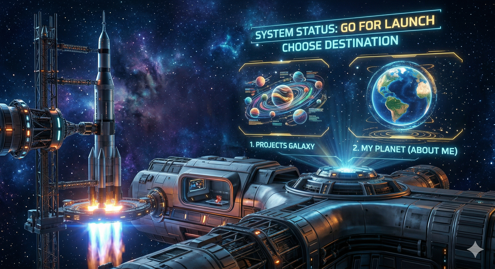

# Scene X:

The Warp

Here is how I’m picturing the layout based on your description:

* **Camera Placement:** Positioned low, right near the base/thrusters of the rocket, looking "up" the length of the ship toward the nose.
* **The Split (The 50/50 Rule):** * **The Right Side:** The rocket’s hull fills this half of the frame. Because it’s a "highly reflective surface," it acts like a curved mirror. We see the **Endgame-style star-tunnel** and the blue/white warp streaks mirrored on the polished metal. The reflection will be slightly curved and distorted by the rocket's shape.
  * **The Left Side:** This is the "actual" space. We see the direct view of the stars collapsing into that violet and blue vortex.
* **The Visual Link:** The streaks of light in the reflection should perfectly align with the streaks in the direct space, creating a seamless flow of motion across the whole image.

### The Technical Details

* **Surface Texture:** The rocket shouldn't look like dull gray metal. It should look like  **liquid chrome or polished obsidian** , so the reflection is crisp and "pops" against the dark hull.
* **Vortex Effect:** Instead of just straight lines, we’ll describe the stars "spiraling" or "tunneling" to give it that specific *Endgame* feel as they head toward the planet.

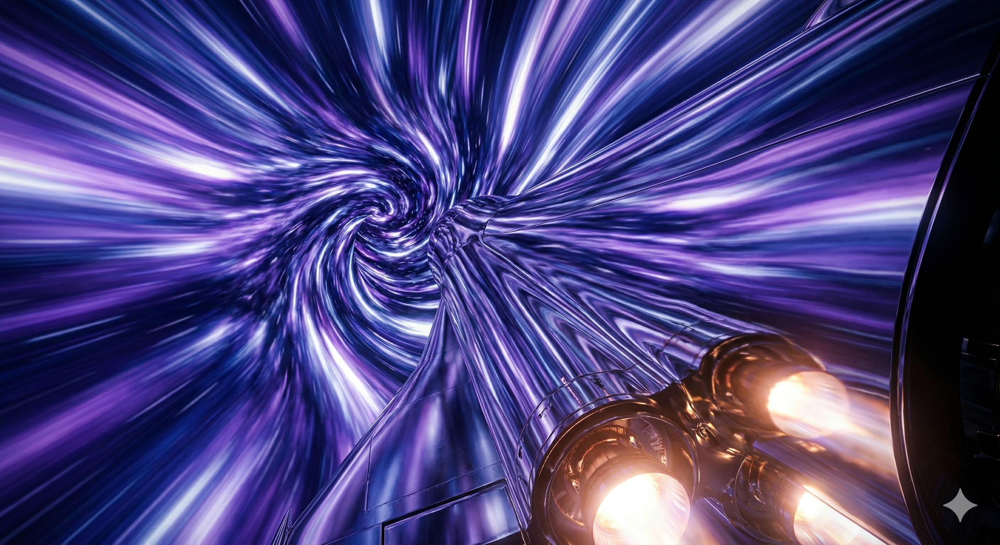

# Scene 3:

### Beat 1: The Warp Collapse

The violent vortex of the hyperspace tunnel suddenly "snaps" and vanishes. The silence is brief but heavy. Ahead, the massive, curved horizon of the planet fills the frame—vibrant blue oceans, swirling white cloud banks, and the dark, deep shadows of the night side. The rocket is moving at a terrifying speed, directly toward the thin, glowing line of the atmosphere.

### Beat 2: The Friction Threshold (The Burn)

As the rocket hits the upper exosphere, the 50/50 split effect evolves:

* **The Left (Space):** The deep black of space starts to turn a hazy, bruised purple and then a violent, glowing orange as friction begins.
* **The Right (The Mirror Hull):** The polished liquid-chrome surface of the rocket reflects the  **plasma fire** . Instead of star-streaks, we see tongues of crimson and gold flame licking across the metal. The heat is visible as a shimmering distortion in the air.

### Beat 3: The "Cloud Piercer"

The rocket plunges into a massive, dark super-cell storm layer.

* **The Visual:** For a few seconds, everything goes "gray-out." Lightning flashes—electric cyan and deep violet—illuminate the cockpit glass from the outside.
* **The Sensation:** You can almost feel the vibration of the ship fighting the wind resistance.

### Beat 4: The Reveal of the Monolith

The rocket punches through the bottom of the cloud layer. The chaos of the fire and the gray clouds disappears.

* **The View:** Below is a vast, ink-black ocean under a twilight sky.
* **The Target:** Standing alone in the middle of the dark water is the  **Knowledge Monolith** —that obsidian tower pulsing with gold and cyan data-lines.
* **The Action:** The rocket’s landing legs deploy with a heavy mechanical  *clunk* , and the retro-thrusters fire to slow the descent.

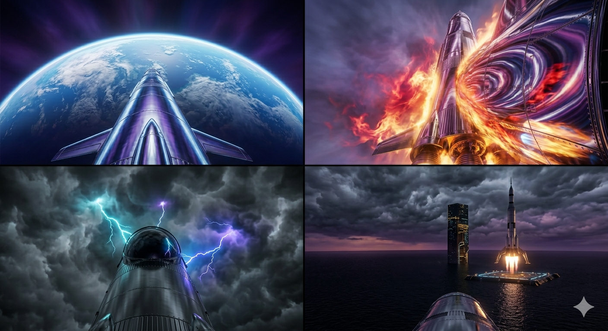

# Scene 4:

Here is the plan for the first three faces of the Monolith:

### Face 1: The Personal Identity

This is the "Home" screen. It focuses on **who** you are and how to reach you.

* **The Hero:** Your **Name** in large, glowing 3D holographic text.
* **The Contact Grid:** Your **Email** and **Contact Number** etched into the obsidian.
* **The Location:** Your **Address** represented by a glowing 3D coordinate pin or a localized map.
* **The Social Links:** Pulsing icons for your **LinkedIn** and **GitHub** at the base.

### Face 2: The Timeline (The Journey)

As the Monolith thrums and rotates 90°, we see your growth from school to industry. We can style this as a **vertical glowing track** with timestamps.

* **The Schooling Era:** `[Start Date] – [End Date]` — Foundation years.
* **The Academic Forge:** `[Start Date] – [End Date]` — Your time at **CBIT (Mechanical Engineering)** and  **University of Hyderabad (Computer Science)** .
* **The Industry Ascent:** `[Start Date] – [Current]` — Your professional journey, including key roles at companies like **HBL Limited** and  **Hexagon** .
* **The AI Pivot:** A special highlighted section for your  **AI/ML certification (2023)** , showing where you bridged the gap between engineering and intelligence.

### Face 3: The Industrial & Tech Arsenal

Since the first two sides cover your identity and history, this third face should showcase your  **actual power** . I suggest we call this **"The Systems Core."**

* **The Tech Stack:** Glowing 3D logos for **Python** and **Rust** that the user can interact with.
* **Industrial Schematics:** Holographic blueprints of **Oil Refineries** and  **Gas Turbines** .
* **The Knowledge Hub:** A 3D web representing your work with  **Knowledge Graphs** , showing how you map different domains together.

### Face 4: The Vision (Optional Proposal)

For the final side, we could have **"The Future Log."** This could be a space for your current research, upcoming goals, or a direct "Call to Action" (like a button to download your resume).

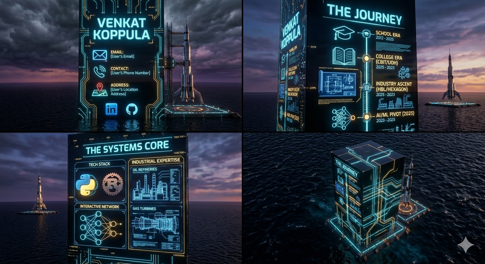

# Scene 5:

That "Endgame" warp style is perfect for transitioning into the  **Projects Planetary System** . It sets the stakes high—like you're jumping across galaxies to reach the core of your work.

Since we are focusing on the  **warp to the Projects System** , we want the visuals to feel faster and more intense than the previous jumps.

### The Projects Warp: Visual Breakdown

* **The Vortex:** Instead of just blue and white streaks, let's infuse the vortex with  **data-packets** . Imagine the "Endgame" tunnel, but within the streaks of light, you see faint, flickering binary code or glowing circuit nodes in cyan and gold.
* **The 50/50 Mirror:** We’ll stick to your favorite composition.
  * **Direct View (Left):** The raw, spiraling hyperspace tunnel.
  * **Reflected View (Right):** The liquid chrome rocket hull. The reflection isn't just a mirror; it should show the metal "stretching" under the G-force of the jump.
* **The Target:** Deep in the center of the vortex, we see a cluster of planets—the  **Projects System** . Each planet represents a major field of your expertise (Industrial AI, Knowledge Graphs, etc.).

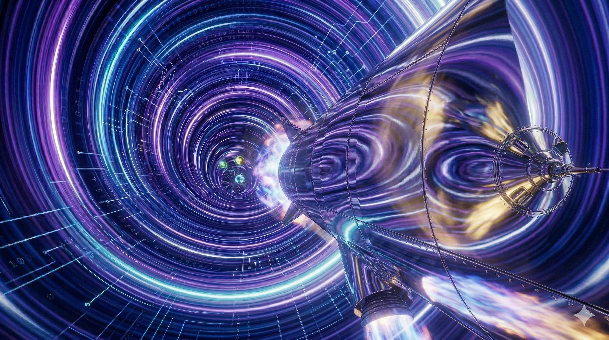

# Scene 6:

### Project planetary system: The Master Projects Horizon (Big picture / First Impression)

**Composition:**
A wide-angle, cinematic 3D WebGL render in a high-angle, 3/4 box perspective looking down onto the solar system on the X-Z plane. The bounding box outlines from image_32.png are  **ENTIRELY ABSENT** , replaced by the vast, open deep-space void. The composition emphasizes depth and cosmic scale.

**Core:**
The central Data Sun is a pulsing white-gold core of pure information, embedded with swirling binary data streams.

**Zone 1: The Inner System (Main Planets)**
Three multi-colored Main Planets (the Industrial, Neural, and Logic worlds) remain in the inner zone, randomly spaced along their orbits. Their  **orbital rings are sharp, distinct, clearly defined, glowing cyan lines** , defining the central hierarchy.

**Zone 2: The Outer System (The Change)**
This extensive outer 'Dwarf/Star' zone features four to five Dwarf Planets appearing as tiny, intense points of light, resembling sharp crystalline stars with precise 4-point lens flares (mostly data-neutral white/cyan).

**Zone 2 Orbits:** The visual change is now critical. The dwarf planets' orbits are  **BARELY VISIBLE** , consisting of **faint, ghostly, highly translucent, ethereal threads of light** that are almost lost against the deep space background. To emphasize lack of clarity,  **one or two dwarfs appear completely isolated** , with  **no discernible orbital path whatsoever** , looking like rogue captured stars. The visible dwarf orbits are chaotic, eccentric, and fragmented.

**Visual Details:**
The scene is set against a  **Vast, Deep-Space Void** . Distant, ethereal nebulae in ghost-like blue and purple hues swirl in the deep cobalt void. A sharp, sparse field of ancient star points and faint, distal galaxies covers the entire background. The scene is vast, cold, and awe-inspiring, emphasizing engineering complexity within a cosmic framework. No rocket is present.

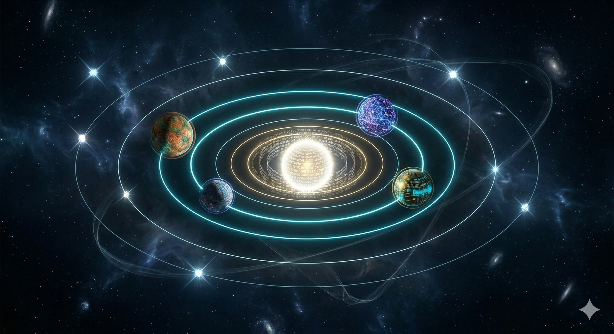

# Scene 7:

### The Interactive Focus (Hover State)

### 1. Camera & Perspective

* **The Subtle Zoom:** The camera performs a smooth, dampened **10% zoom** toward the targeted planet. This creates a "focus" effect without breaking the isometric 3/4 perspective or losing sight of the Data Sun.
* **Parallax Depth:** The background nebulae and distant galaxy clusters shift slightly slower than the foreground elements, giving the user a tangible sense of the cosmic void's volume.

### 2. The Planet’s "Hero" Transformation

* **The Presentation Pose:** The planet immediately halts its orbital movement along the X-Z plane. It rotates slowly on its own axis to reveal its  **"Good Side"** —the face with the highest density of glowing industrial grids, neural lattices, or logic textures.
* **Atmospheric Ignition:** A high-intensity **Fresnel Glow** (cyan for AI/Logic, amber-orange for Industrial) ignites around the planet's rim, creating a vibrant halo that makes it "pop" against the deep black of space.

### 3. The "Universal" Cinematic Title

* **3D Extruded Text:** Glowing, metallic 3D text (e.g., **"NEURAL CORE"** or  **"REFINERY AI"** ) emerges from behind the planet.
* **The Arc:** The text follows a curved path over the planet’s  **North Pole** .
* **Visibility Rule:** The text is elevated and angled so that the top curve of the planet never occludes the letters; the title is 100% readable and appears to "float" as a halo of data.

### 4. The Orbital Feedback

* **Neon Surge:** The specific cyan orbital ring belonging to the hovered planet transitions from a faint, translucent thread into a  **bold, thick, pulsating neon track** .
* **Kinetic Pulse:** A wave of high-intensity light races around this specific orbit in a continuous loop, signaling that the project path is "Active" and ready for a command.

### 5. The UI Layer (Mouse Interaction)

* **The Cursor:** We maintain the **standard white OS mouse pointer** for familiarity and precision.
* **The Tooltip:** Anchored to the bottom-right of the cursor is a sleek, semi-transparent  **glass-morphism textbox** . Inside, the word **"Click"** is rendered in a sharp, monospaced terminal font (e.g., JetBrains Mono), subtly pulsing to invite the interaction.

### **Summary of the "Vibe"**

The user moves their mouse over the "Industrial" planet. The system reacts instantly: the camera leans in, the planet stops to "greet" them, its name arcs over the top in a cinematic glow, and the orbit flares like a neon highway. It feels like the entire system is waiting for the user's next move.

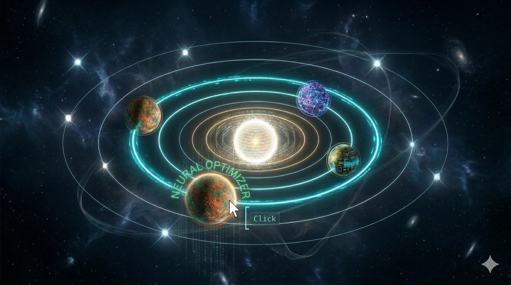

# Scene 8:

## The Planetary Deconstruction (The Click)

Here are the **three cinematic beats** for the  **Planetary Deconstruction** :

### Beat 1: The Tectonic Rupture (The "Exploded View")

* **Action:** Upon clicking, the camera zooms in aggressively until the planet occupies the majority of the frame.
* **Visual:** The planet’s surface fractures into high-poly "tectonic" chunks that drift outward on their local axes.
* **The Reveal:** The internal anatomy is exposed. You see a **Glow-Core** (the foundational logic) and a **Lattice-Mantle** (the processing layer) spinning at different speeds within the shards.

### Beat 2: The Solar Bridge (The "Light-Form")

* **Action:** A high-intensity, needle-thin beam of white-gold light shoots from the distant  **Data Sun** , piercing through the gaps in the floating planet chunks.
* **Visual:** As the ray hits the space behind the planet, it "refracts" and flattens out, instantly manifesting a translucent, high-tech  **Holographic Screen** .
* **Movement:** The screen "unfurls" from behind the planet’s left edge and stretches across to the right, creating a sense of a physical connection between the Sun’s energy and your project data.

### Beat 3: The Tech Anatomy (The "Data Blade")

* **Action:** Text labels and UI elements materialize across the deconstructed layers and the new screen.
* **Visual - The Planet:** The core glows with **"Python/Rust"** markers; the mantle pulses with **"ML/RL"** signatures; the floating crust shards flicker with **"Flask/API"** tags.
* **Visual - The Screen:** To the right, the "Data Blade" displays the  **Project Title** ,  **Use Case** , and **Technical Solution** in a sharp, monospaced terminal font.

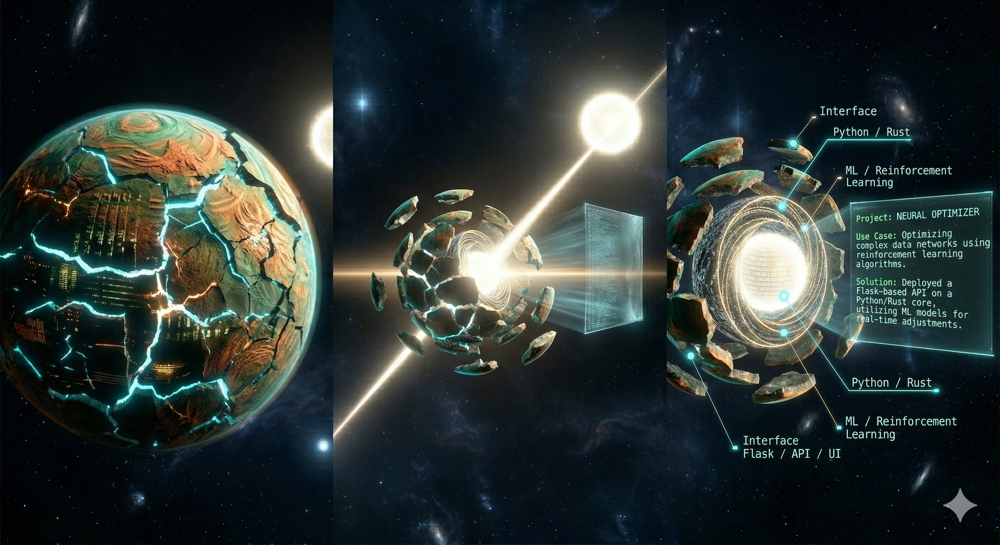

# Scene Y:

### The "Reverse-CRT" Rewind Effect

#### 1. The Motion (The Reverse)

* **The Pullback:** The camera, which was fixed on the Monolith, suddenly yanks backward with extreme velocity.
* **The Visuals:** The Monolith shrinks rapidly in the distance. The dark ocean and the storm clouds rush *toward* the camera and then disappear behind it.
* **The Re-entry:** We see the glowing plasma fire from the atmospheric entry (Scene 3) appearing *around* the camera again, but moving in the opposite direction (pulling away from the planet).

#### 2. The CRT Filter Overlay (The 90s Vibe)

* **The Convex Tube:** The edges of the screen "bulge" slightly, as if the entire 3D world is being projected onto a heavy, curved glass 90s TV screen.
* **Scan Lines & Flicker:** Thick, dark horizontal scan lines roll slowly down the screen. A constant, subtle high-frequency flicker makes the highlights "buzz."
* **Color Bleeding (Chromatic Aberration):** The sharp cyan and gold lights of the Monolith start to "bleed" or ghost, with purple and green fringes at the edges of every object.
* **Tracking Noise:** A jagged horizontal band of white static noise (VHS tracking) occasionally snaps across the middle of the frame to sell the "rewind" feel.

### Examples: Here are the three definitive **CRT Rewind** behaviors.

### Rewind Scene 1: The Project Collapse (Neural Optimizer → System View)

* **Start State:** The "Exploded View" of the planet. Shards are floating, the core is glowing, and the tech-stack labels (Python/ML) are visible.
* **The Rewind:** A sudden **horizontal sync-slip** causes the planet to "jitter" violently. Thick, semi-transparent tracking bars (VCR style) roll up the screen. The background fades to a flat, deep black to make the glitching colors pop.
* **The Reset:** The "Click" textbox on the cursor flickers and disappears. The planet shards snap back together like a magnet, and the camera pulls back to the wide-angle Solar System view.
* **UI Text:** `<< REWINDING SESSION_01 // CACHE_CLEAR`

### Rewind Scene 2: The Warp Snap-Back (The Tunnel → The Gantry)

* **Start State:** High-speed motion blur within the "Data Warp" tunnel. Binary code is streaming past the rocket.
* **The Rewind:** The forward motion "freezes" for a frame, then plays in  **high-speed reverse** . The blue warp-streaks turn into jagged, distorted "snow" (analog noise). The screen color de-saturates into a high-contrast monochrome (black and white) briefly.
* **The Reset:** The camera "lands" back on the metallic Gantry. The rocket’s engines go from a bright blue flare to a cold, dead gray in a single frame.
* **UI Text:** `<< EMERGENCY REENTRY // POINT: ALPHA_GANTRY`

### Rewind Scene 3: The Earth Reversion (Statue → Earth View)

* **Start State:** A cinematic close-up of **Earth** with the massive **Obsidian Statue** standing on its surface.
* **The Rewind:** A "Signal Loss" effect hits. The image of the statue glows bright white (phosphor burn) and then "bleeds" out into the black space. The Earth itself appears to "shrink" rapidly as if being sucked into a vacuum.
* **The Reset:** The CRT static clears to show Earth as a simple, small planet from a distance. The statue is no longer visible. The camera "lands" back on the metallic Gantry. The rocket’s engines go from a bright blue flare to a cold, dead gray in a single frame.
* **UI Text:** `<< SIGNAL_DROP // RETURNING TO SYSTEM_ORBIT`

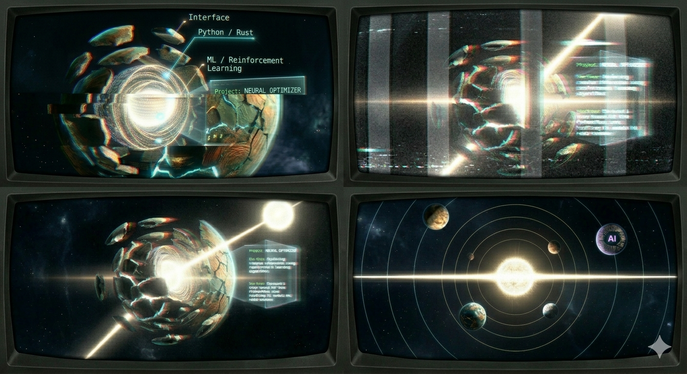

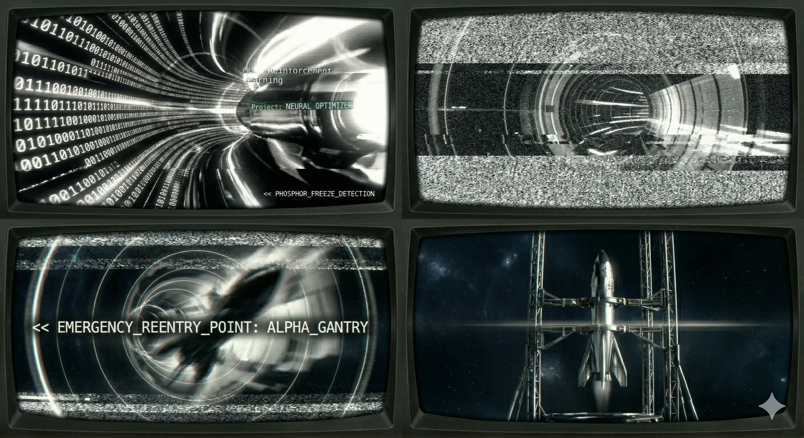
